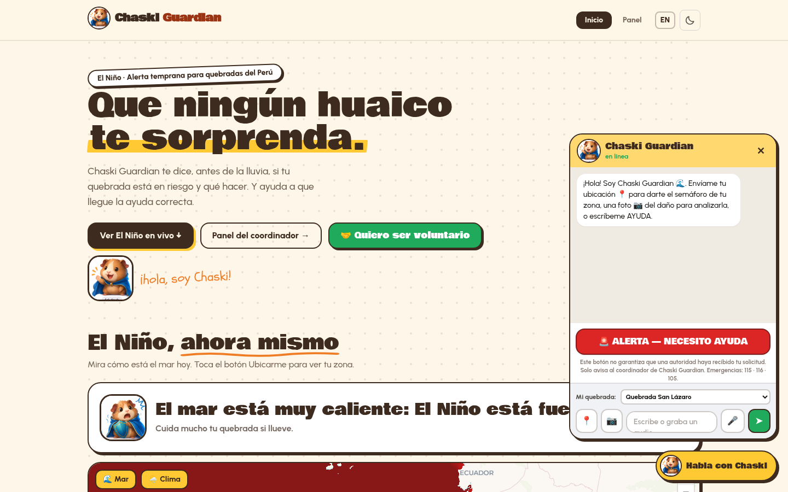
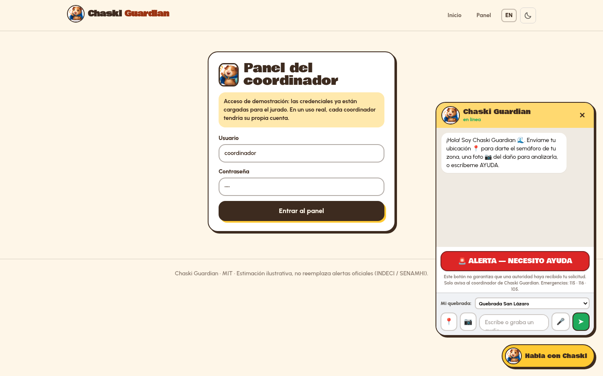
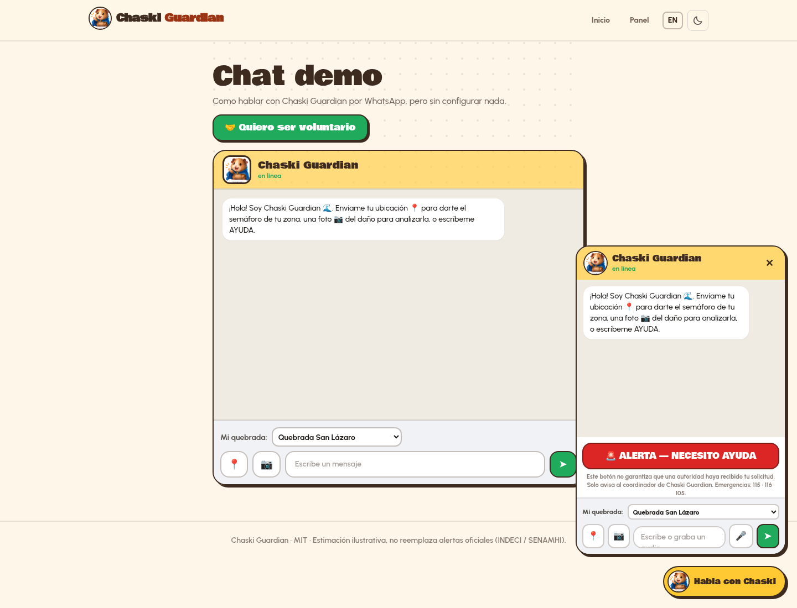
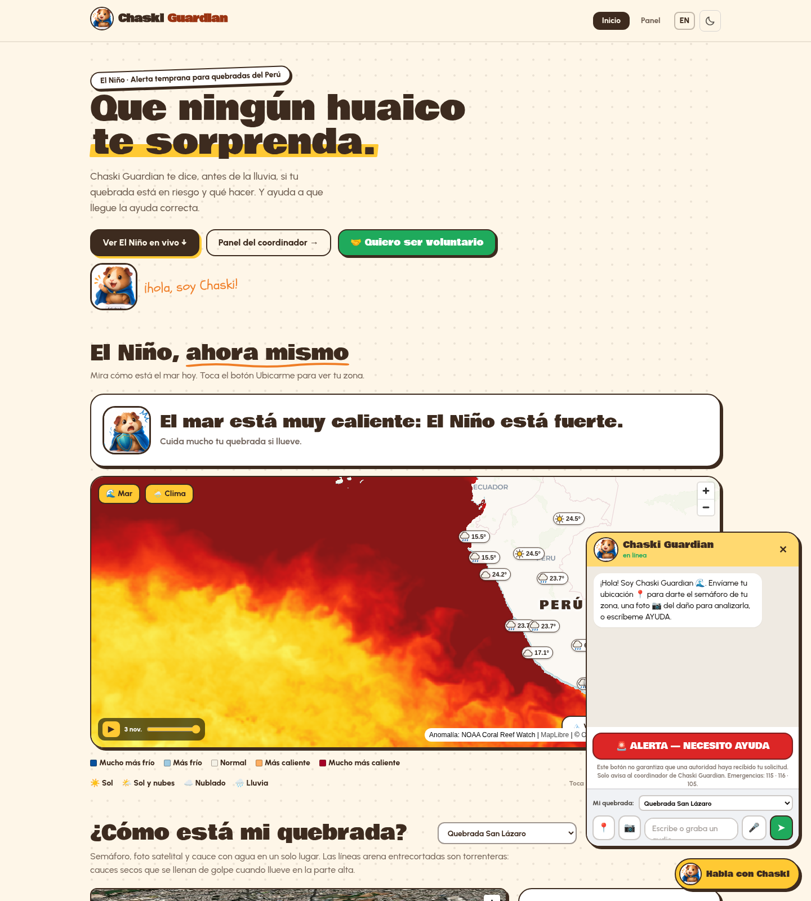

# Chaski Guardian

[](https://cerebralvalley.ai/e/meta-ai-developer-hackathon)
[](https://cerebralvalley.ai/e/meta-ai-developer-hackathon)
[](LICENSE)
[](https://nextjs.org/)
[](https://dev.meta.ai/docs)

> **WhatsApp-first early warning for El Niño floods and landslides in Peru's ravine neighborhoods.**  
> Report → Evaluate → Act — before the water rises.

**Track:** Indie developer · **Theme:** Build for Your World  
**Live demo:** https://chaski-guardian.vercel.app/  
**Demo video:** https://youtu.be/qn2WQ80TCKE (narrated in Spanish; English subtitles could not be configured in time - enable YouTube auto-translate captions > English)  
**Repo:** https://github.com/fenyx144/chaski-guardian

---

## The problem I know firsthand

I live in **Arequipa, Peru**. Every El Niño season, rain fills dry quebradas (ravines) in minutes. Families living at the edge get late or unclear warnings. Neighbors report damage in WhatsApp groups that coordinators cannot triage. Official alerts exist, but they rarely say *"what should my street do right now?"*

**Chaski Guardian** is built for that gap: a community channel that turns a photo, a voice note, or a location into a clear traffic light — and helps the right help arrive, with a human always in control.

---

## Solution flow

| Step | What happens |
|------|----------------|
| **1. Reportar** | Neighbor sends a photo, voice note, location, or short text (WhatsApp-style chat / demo UI). |
| **2. Evaluar** | Muse Spark analyzes the photo and combines it with rain + quebrada context into a **green / yellow / red** risk signal and plain-language actions. |
| **3. Actuar** | Coordinator reviews reports, approves crew missions, and neighbors see what to do — plus emergency numbers. |

A human **always** approves crew missions. **No-go / forbidden zones** are enforced in code so the system cannot dispatch people into blocked areas.

---

## Screenshots

| Home | Coordinator panel |
|------|-------------------|
|  |  |

| Chat demo | Risk / map view |
|-----------|-----------------|
|  |  |

---

## Meta models used

| Model | Where | Why it matters |
|-------|--------|----------------|
| **`muse-spark-1.3`** | `/api/analyze`, mission proposals, alert copy | Vision + text: photo risk analysis, short Spanish actions, crew-mission drafts for human approval |
| **`muse-voice-transcribe-1.0`** | `/api/transcribe` ← wired into the chat mic button | Neighbors can **speak** a report when typing is hard in the rain |

Models are called through the **Meta Model API** (`https://api.meta.ai/v1`). No keys are committed; see `.env.example`.

---

## Product features

- **WhatsApp-first UX** — chat demo mirrors WhatsApp; production path uses **WhatsApp Cloud API** (with a clear simulated fallback when env vars are missing).
- **Quebrada traffic light** — rain context (Open-Meteo) + local quebrada selection + optional photo analysis.
- **El Niño live map** — sea-surface anomaly context via **NOAA Coral Reef Watch**; weather layer via Open-Meteo.
- **Coordinator panel** — reports, proposed missions, approve / reject. Demo login prefilled for judges.
- **Volunteer signup** — neighbors can offer help; crews move only after human approval.
- **Languages:** **Spanish, English, and Quechua** (`es` / `en` / `qu` in `lib/i18n.tsx`).
- **Emergency numbers on screen:** **115 INDECI · 116 Bomberos · 105 Policía · 106 SAMU** — Chaski never replaces official response.
- **Honest safety copy** — green does **not** mean “safe”; insufficient data is called out.

---

## Evidence

- **Automated tests:** `npm test` — **13 tests** covering risk logic, forbidden zones, and store helpers.
- **Photo analysis trial** (AI-generated *example* images only — not real field validation):

| # | File (in `Downloads/fotos`) | Expected (author label) | Muse result | Match? |
|---|------------------------------|-------------------------|-------------|--------|
| 1 | `foto 1.jpg` dry quebrada, clear sky | low | low (`leve`) | Y |
| 2 | `foto 2.jpg` debris in channel | medium | low (`leve`) | N |
| 3 | `foto 3.jpg` muddy water in quebrada | high | high (`grave`) | Y |
| 4 | `foto 4.jpg` flooded street | high | high (`grave`) | Y |
| 5 | `foto 5.jpg` water near bridge deck | high | high (`grave`) | Y |
| 6 | `foto 6.jpg` landslide on road | high | high (`grave`) | Y |
| 7 | `foto 7.jpg` quiet Arequipa street | low | high (`grave`) | N |
| 8 | `foto 8.jpg` rocky channel, light water | medium | high (`grave`) | N |

**Score: 5 / 8** — POSTed each file to `/api/analyze` on the live demo (2026-11-05). These are **AI-generated example images, not real field photos**; treat as a coherence check. Real neighbor photos are the next validation step. Note: `foto 7.jpg` and `foto 8.jpg` are byte-identical (same size); both were classified as bridge flooding (`grave`).

---

## Honest limits

- Demo WhatsApp send may target a **verified test number** (Cloud API free tier: up to 5 numbers). Judges see the alert text and “sent to N neighbors (simulation)” in the panel when live send is unavailable.
- Risk scores are **illustrative estimates**, not official SENAMHI/INDECI alerts.
- JSON file store (no production DB yet).
- Photo trial above uses AI-generated images — treat as coherence check, not accuracy claim.

---

## Run locally

```bash
git clone https://github.com/fenyx144/chaski-guardian.git
cd chaski-guardian
npm install
cp .env.example .env.local
# set MODEL_API_KEY (and optional WhatsApp vars) — never commit .env.local
npm run dev
```

Open http://localhost:3000 · Panel `/panel` · Chat `/chat`

### Env vars (names only)

| Variable | Purpose |
|----------|---------|
| `MODEL_API_KEY` | Meta Model API key |
| `MODEL_BASE_URL` | optional, default `https://api.meta.ai/v1` |
| `MODEL_NAME` | optional, default `muse-spark-1.3` |
| `WHATSAPP_TOKEN` | WhatsApp Cloud API temporary/permanent token |
| `WHATSAPP_PHONE_ID` | Phone number ID |
| `COORDINATOR_PASSWORD` | panel gate (if configured) |

---

## Stack

Next.js 14 (App Router) · TypeScript · Tailwind · Framer Motion · MapLibre GL · three.js · Open-Meteo · NOAA Coral Reef Watch · Meta Model API

---

## Roadmap

1. Multi-subscriber WhatsApp alerts via verified Cloud API templates  
2. Field validation with real quebrada photos from neighbors  
3. SENAMHI/INDECI feed integration (read-only)  
4. Lightweight auth for multiple coordinators  
5. Offline-first PWA for low connectivity

---

## Why this fits the hackathon

- **Indie developer track** — built alone, end-to-end, for a community I live in.  
- **Build for Your World** — El Niño risk in Arequipa quebradas is a firsthand problem; Meta models turn photos and voice into actionable local warnings.

---

## License

MIT © Diego Rivas Revilla (Arequipa, Perú)
